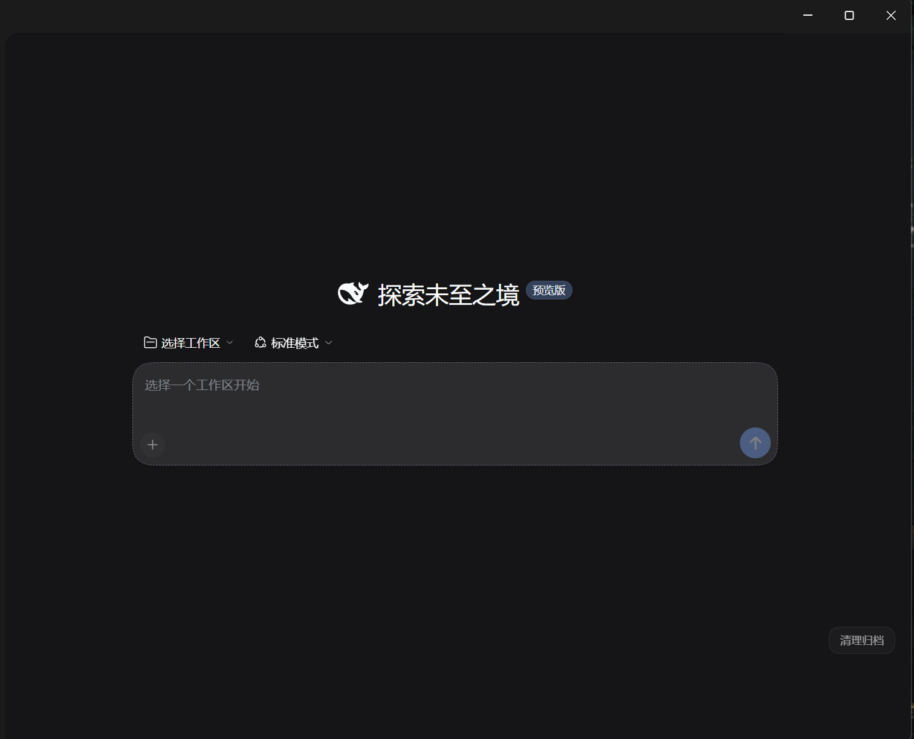
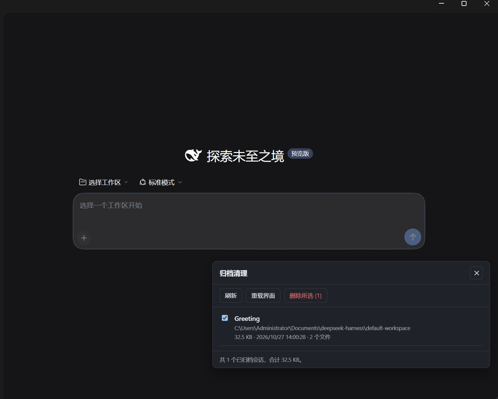

# dsh-archive-cleanup

> DeepSeek Harness 插件：列出并**物理删除**已归档会话的磁盘数据。没有回收目录，删了就没了。

DSH 的「归档」只是把 session id 写进 `$DSH_HOME/storages/workspace.json` 的
`global.archivedSessionIds`，会话正文（`$DSH_HOME/sessions/<bucket>/<id>/session.v4.jsonl.zstd`）
和投影缓存（`$DSH_HOME/storages/session_projcache/sessions/<id>.json`）原封不动留在磁盘上。
侧边栏看不见，不等于删掉了。这个插件补上「归档之后」那一步。

## 截图

| 右下角入口 | 面板（勾选后删除） |
|---|---|
|  |  |

面板是右下角的浮动卡片，不铺全屏遮罩；上面这张是选中 `Greeting` 这一条待删会话时的样子。

## 两种用法

### 1. 应用内浮动面板

重启后窗口**右下角**有一个半透明「清理归档」胶囊，点开是右下角浮动卡片（不是全屏遮罩，应用其余部分照常可用）：

1. 勾选会话 → `删除所选 (N)`；
2. 面板顶部出现确认条：`确认删除` / `取消` 两个按钮（不再要求输入 yes）；
3. 底部显示「已删除 N 个，释放 X KB」，列表与左侧工作区同时更新。

面板打开期间每 4 秒软刷新一次，切回窗口时也会刷一次：会话在侧边栏改名后，这里 4 秒内跟着变；
勾选状态按 session id 记住，刷新不会丢。

### 2. 交给 Agent

| action | 行为 |
|---|---|
| `inspect` | 列出全部归档会话：标题、工作目录、体积、最后修改时间 |
| `delete` | 删除日志与投影缓存，并把 id 从归档集合移除（**不可恢复**） |

`delete` 必须显式传 `confirm:"yes"`，否则自动降级成 `inspect` 预览；`ids` 省略表示全部。

会话标题取的是侧边栏显示的那个名字（`storages/session_projcache/sessions/<id>.json`
里的 `record.rows.title.val`），不是 session id；缓存缺失时才退回日志里的标题事件。

## 安全边界

- 只处理 `archivedSessionIds` 里真实存在的 id，没归档的会话一律拒绝。
- 先校验磁盘数据：只剩投影缓存、或什么都没剩的幽灵条目，直接从归档集合清掉并报告
  `no-data-on-disk`，不假装删了什么。
- 只碰两类路径：`sessions/<bucket>/<id>/` 和 `storages/session_projcache/sessions/<id>.json`。
- 注册表操作走 `ctx.workspaceRegistry.unarchiveSession()`（每次请求实时取当前服务），
  不跟运行中的 DSH 抢写 `workspace.json`。
- 删除后由 Host 发 `api-session/removed`，客户端立刻把那一行从列表里摘掉，不用重启。
- Web 接口 `POST/GET /dsh-archive-cleanup/api` 有三道闸：必须带
  `x-dsh-archive-cleanup: 1`（跨站自定义头会触发预检被浏览器拦下）、有 Origin 时校验同源、
  删除还要 `confirm:"yes"`。

## 结构

```
index.js           Host 入口：archive_cleanup 工具 + HTTP 路由 + 面板注入
lib/core.js        扫描 / 删除（不依赖 Cordis，可单独测）
lib/http.js        Web 接口（list / delete / probe 诊断）
lib/inject.js      注入到应用首页的浮动面板（纯 DOM，无 iframe、无全屏遮罩）
test/*.mjs         冒烟测试（工具逻辑 / HTTP 接口 / 注入面板）
```

## 安装

### 从 GitHub 装（推荐）

在插件页 **Plugins → Add plugin** 里填 `github:pogacartadej51-max/deepseek-harness`，
或者用 Host 的 plugin manager：`install_bundle` + 同一个 spec。

> 前提是本机能 `git ls-remote` 到 GitHub；公司网络/大陆网络经常失败，
> 那种情况用下面的本地目录方式。

### 本地目录装

```jsonc
// ~/.dsh/profiles/desktop/package.json
"dependencies": { "dsh-archive-cleanup": "link:C:/path/to/dsh-archive-cleanup" },
"dsh": { "profile": { "bundles": [ /* ... */ "dsh-archive-cleanup" ] } }
```

在 profile 的 `node_modules` 里建指向本目录的 junction/symlink 后重启 DSH。

## 兼容性

这个插件用到的是 DSH 的**内部机制**，不是公开插件 API，所以版本兼容要写清楚：

| 依赖点 | 用途 | 失效表现 |
|---|---|---|
| `webserver/index-inject` 注入行 | 把浮动面板塞进页面 | 面板不出现，工具仍可用 |
| `webServer.register` | `/dsh-archive-cleanup/api` | 面板不可用，工具仍可用 |
| `ctx.workspaceRegistry.archivedSessionIds / unarchiveSession` | 读归档集合、清理登记 | 无法列/删 |
| `api-session/removed` 事件 | 删除后让侧边栏立刻少一行 | 需要重载界面 |
| `session_projcache` 的 `record.rows.title.val` | 显示会话名 | 退回显示 session id |

测试环境：DSH Desktop **0.2.1-rc.2**、Windows 11、Node 24。升级 DSH 后请先跑
`node test/*.mjs`，再实际开一次面板确认。

面板是往宿主页面注入 DOM，属于“能用但非官方”的做法；官方路线是写 Web 客户端插件
（要走 Typert Remote 构建产物），成本高得多。短期我会保持注入式，并在 DSH 大版本
更新后重新验证。

## 安全与隐私

- 只删 `$DSH_HOME` 下的会话日志与投影缓存，不碰别处；删除不可恢复（没有回收目录）。
- HTTP 接口只监听本机，且要求自定义请求头 + `confirm:"yes"`；但它**不是**带鉴权的 API，
  本机其它进程理论上可以调用 —— 这是“本机工具”的威胁模型，不是多用户服务。
- `$DSH_HOME/storages/archive-cleanup/api.log` 会记录 session id 与删除结果（不含会话正文）。
  分享日志前请自行检查。

## 测试

```powershell
npm test
# 等价于下面三条
node test/smoke.mjs   # 工具逻辑
node test/api.mjs     # HTTP 接口（含越权与误删拦截）
node test/ui.mjs      # 注入面板（DOM 垫片 + 真实 handler）
```

都不启动 DSH：用假 ctx / 假 registry + 临时 `DSH_HOME`，不会碰真实会话。
CI 在 `.github/workflows/test.yml`，跑 Ubuntu / Windows / macOS × Node 22/24。

## 诊断

每次接口调用都会追加一行到 `$DSH_HOME/storages/archive-cleanup/api.log`
（`list` 轮询不记，避免刷屏）；注入面板的进度与未捕获异常也会以 `action=probe` 回传。

## License

[MIT](LICENSE)

